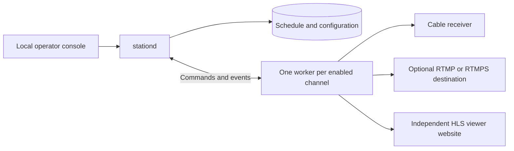

# CivicCast Lite user manual

This guide covers the public [v0.1.0.13 prerelease](https://github.com/scottconverse/civiccast-lite/releases/tag/v0.1.0.13). Use the operator console to run the station. Viewers watch through an independently hosted website, a cable receiver, or a streaming provider.

## New users

### Install and open the console

Download the package for your station machine and `SHA256SUMS.txt` from the [release](https://github.com/scottconverse/civiccast-lite/releases/tag/v0.1.0.13). Compare the downloaded file's SHA-256 digest with the matching line in the checksum file. Use `Get-FileHash -Algorithm SHA256 <file>` on Windows, `shasum -a 256 <file>` on macOS, or `sha256sum <file>` on Ubuntu. If the digest differs, download a fresh copy and check again before installing.

| Platform | Package and installation | Operator console on the station |
| --- | --- | --- |
| Windows x64 | `CivicCast-Lite-0.1.0.13-windows-x64-setup.exe`. Check with `Get-AuthenticodeSignature`. Expect a valid Scott Converse Authenticode signature. Run the setup executable with administrator approval. | `http://127.0.0.1:4070/` |
| macOS on Apple silicon | `CivicCast-Lite-0.1.0.13-arm64.pkg`. Open the package in Installer or run `sudo installer -pkg CivicCast-Lite-0.1.0.13-arm64.pkg -target /` from the download folder. The station binaries have ad hoc signatures. Local macOS installation policy applies. | `http://127.0.0.1:8787/` |
| Ubuntu 26 amd64 | `CivicCast-Lite-0.1.0.13-ubuntu26-amd64.deb`. From the download folder, run `sudo apt install ./CivicCast-Lite-0.1.0.13-ubuntu26-amd64.deb`. | `http://127.0.0.1:8787/` |

The installed service binds to the station's loopback address. Open the console on the station itself. Some console titles and Windows paths display TownLight Station. macOS and Ubuntu retain the CivicCast Lab identifiers listed below.

### Create the first operator

1. On Windows, use the first-operator link supplied by the installer. On macOS and Ubuntu, have the administrator use the protected `operator-bootstrap.capability` handoff in the state directory listed below. The local setup URL has the form `http://127.0.0.1:8787/#/setup/<capability>`. Treat the one-time value and the complete link as credentials.
2. Enter the account details and choose **Create account securely**. Save the one-time recovery codes in protected storage before leaving the screen.
3. Continue to the station or sign in. For a forgotten password, use **Use a recovery code** on the sign-in screen. If the initial link expired before any account was created, have the station administrator reissue the protected handoff.

### Schedule a recorded program

1. In the media library, use **Import media** with a path the station service can read. Watch ingest and wait for the asset to reach **Ready**.
2. In **Schedule**, select the intended channel. Under **Create manual draft**, choose the ready asset, enter the title, and set the start time. Check the time against the station's programming schedule.
3. Leave **Air duration (seconds)** at the asset's measured duration to run the entire program. For a 4-hour, 25-minute meeting, the full duration is 15,900 seconds. Leave room for that duration before the next program.
4. Select **Prepare commit**. Review the channel, start, duration, conflicts, and missing-media messages. Once the preview is clear, select **Approve & commit to air**.
5. Check the committed entry and then the on-air state at the scheduled start. Watch and listen at the intended destination to confirm delivery.

On builds from `main` with the scheduling fix, enter the start time in the station time zone shown on the form. If clocks skip or repeat that time during a daylight-saving transition, choose an unambiguous start time.

### Take a live source and return to the schedule

1. Have the setup administrator configure the channel's live source and confirm the sender is feeding it. In the live takeover screen, select the correct channel and source.
2. Enter the reason and select **Request arm**. Wait for **Armed**. The five-minute arm window is the time available to take the source.
3. Select **Take Live** and **Confirm Take Live**. A live take can interrupt a scheduled program. Check **ON AIR** and verify the program on the receiving side.
4. At the end of the show, select **Return to Schedule** and confirm. Check which program is now on air and that each configured destination has followed the switch.

### Check the three destinations

| Destination | What to check |
| --- | --- |
| Cable | Use the configured headend or transport receiver. Tune the expected service and confirm the picture advances and the sound is present. |
| YouTube | In Studio, select the intended private broadcast. While the Lab channel is sending, play the preview and check picture, motion, and sound. The channel's source selection and YouTube's broadcast visibility are separate controls. |
| Station website | Open the station's viewer site, choose the channel, and press **Play**. The website plays the station's own HLS feed and works independently of YouTube. |

## Technical users

### Services, state, and health

| Platform | Supervisor and service status | Private state directory |
| --- | --- | --- |
| Windows | `Get-Service TownLightStation`. Check Windows System log entries from Service Control Manager for service start failures. The install receipt is in the state directory. | `C:\ProgramData\TownLight Station` |
| macOS | `sudo launchctl print system/org.civiccast.lab`. The daemon sends stdout and stderr to `service.log` in the state directory. | `/Library/Application Support/CivicCast Lab/state` |
| Ubuntu | `systemctl status civiccast-lab` and `journalctl -u civiccast-lab -n 100 --no-pager`. | `/var/lib/civiccast-lab` |

Check the console's local `/health` endpoint for service availability. In the console, check the worker and on-air state for the affected channel. Recent send times show local progress. Confirm picture and sound on the receiver as a separate check.

### Configure outputs

**Cable.** Use the channel's authorized output configuration to match the headend's supported MPEG-TS transport profile. Confirm the destination, transport, service assignments, and receiver requirements with the headend operator. Test a short program at the receiver before relying on the path for a live event.

**RTMP or RTMPS.** In **Continuous streaming output**, a Setup Admin selects the channel and enters the full provider ingest URL, including its stream key. Select **Save destination**. Each channel has one continuous streaming destination. Use separate credentials when sending different channels to different YouTube broadcasts. Keep ingest URLs out of issue reports, screenshots, and shell history. **Turn off streaming** disables this branch while leaving cable and portal enabled.

**Independent HLS portal.** Point a static HTTPS web server at the generated viewer directory. The package defaults are `public-portal` under the Windows installation directory, `/Library/WebServer/Documents/civiccast-lab` on macOS, and `/var/www/civiccast-lab` on Ubuntu. Administrators can configure an absolute path through `CIVICCAST_PORTAL_ROOT`. Give the station service write access and the web server read access to that tree. Serve `.m3u8` as `application/vnd.apple.mpegurl` and `.ts` as `video/mp2t`. Revalidate live playlists and `channels.json`, use `index.html` as the default document, and disable directory listing. Keep the console, private state, and credentials outside the web root. [Portal setup](../web/portal/README.md)

### Back up and recover

Back up the station database, channel journals, managed media, and local service configuration as a consistent set. Use a service-stopped backup window for a filesystem copy and preserve file ownership and access permissions. Keep operator recovery codes in separate protected storage.

On macOS and Ubuntu, retain the same `station-master.key` used to protect stored destination credentials. Back it up separately and securely. On macOS it is under `/Library/Application Support/CivicCast Lab/credentials`. Ubuntu's packaged unit loads it through systemd from `/etc/civiccast-lab/credentials/station-master.key`. Windows uses machine DPAPI. Verify credential recovery before relying on restored state on a different machine.

After restore, confirm service health, sign-in, media readiness, the intended schedule and channel state, and receiver playback on each configured path.

### Diagnose problems

| Symptom | Where to look |
| --- | --- |
| Console unavailable | Check the local port, service status, and supervisor logs. |
| Media stays unready | Check the ingest job's reason, source readability, and available disk space. |
| Commit blocked | Check the preview for missing media, conflicting times, and duration. Correct the draft and prepare again. |
| RTMP shows progress but the provider preview is blank | Confirm the channel and matching broadcast in the provider UI, and check the provider's ingest status and preview player. |
| Portal stays stale | Check the generated channel list, playlist and newest segments, then verify the server's MIME types and cache behavior. Resume playback manually if browser policy prevents autoplay. |
| Sound continues but picture freezes | Capture the channel, precise time, source type, receiver, and whether another destination shows the same behavior. Keep the capture and corresponding logs together. |

For capacity checks, record the package version, host, active channels, source types, destinations, and receiver results. Three, six, and nine are test tiers. macOS passed short cable and portal checks at each tier and Ubuntu passed local RTMP receiver recovery. The R7 nine-channel picture freeze, YouTube viewer playback, and physical Ubuntu R9 capacity remain open.

## Architecture

Each enabled channel runs in a supervised worker. The station service manages the media library, schedule, operator accounts, and configuration. A worker uses the current schedule, a confirmed live take, or the fallback source to feed its on-air outputs. If a worker exits, the service starts a replacement and reconciles that channel against its journal and schedule.

The operator console uses a loopback address. Expose only the generated viewer directory through the website's HTTPS server. Keep station state, media, and credentials outside that directory.

The [full architecture](architecture/overview.md) includes diagrams of the runtime and trust boundaries, media routing, scheduled takes, and worker restart. See the [README](../README.md) for release status and test results.
