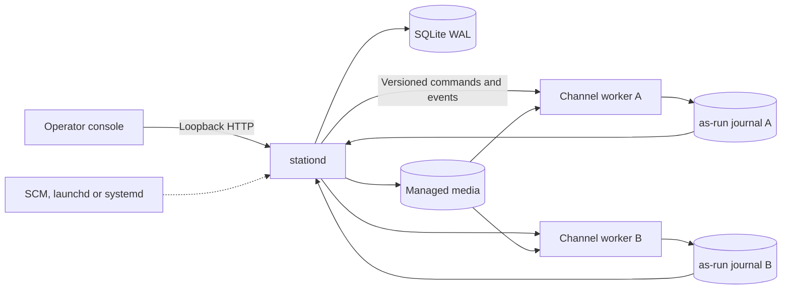
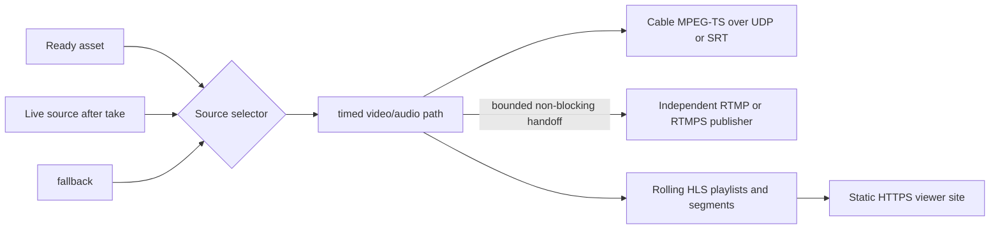
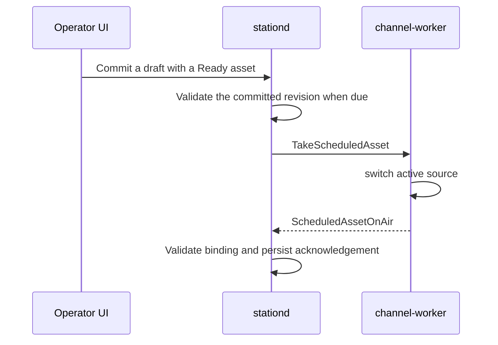

# CivicCast Lab architecture

Private evaluation build v0.1.0.12. The station service manages programming and supervises each channel. Channel workers keep picture and sound moving and feed the configured outputs. See the [user manual](../USER-MANUAL.md) for installation and operation.

## Runtime topology

`stationd` is a single Rust daemon and the sole writer to SQLite (WAL mode). It owns the HTTP operator API, the authorized configuration, ingest, and durable scheduling. The operator UI is a loopback React/TypeScript application served only to the local operator. `stationd` launches one supervised `channel-worker` process per enabled channel; each worker owns a persistent in-process GStreamer 1.28 graph, its own clock, source switching, and a per-channel as-run journal. Worker events correlate to pending requests, and the station projects journal evidence into durable state.

Supervision is platform-native: Windows SCM with protected named pipes and job objects; macOS launchd; Ubuntu systemd. On Unix the worker is launched over an inherited socketpair with peer credential and close-on-exec checks plus process groups. The operator HTTP listener binds to loopback (Windows port 4070, Unix port 8787). Managed media is content-addressed and immutable once stored.

## On-air signal flow

Each channel's persistent graph holds the currently selected source: a scheduled Ready asset, a live source after a confirmed take, or the configured fallback. Arming alone leaves the active source in place. The graph processes video and audio against the channel clock. Cable output uses configured MPEG-TS over UDP or SRT. A bounded nonblocking handoff feeds an optional RTMP or RTMPS publisher. The portal branch writes rolling HLS playlists and `.ts` segments. Those HLS artifacts are then served by a separate static HTTPS site with embedded `hls.js` browser recovery. Stream-key URLs are protected on Windows via machine DPAPI, or on Unix via a separately provisioned AES-GCM key. Only the public generated viewer tree is exposed; the operator surface remains loopback-only.

## Scheduled take sequence

An operator drafts and commits a Ready asset under the scheduling rules. The scheduler validates and dispatches `TakeScheduledAsset`. The worker changes the active source and emits `ScheduledAssetOnAir`. The station validates the exact binding and commits the acknowledgement. Receiver playback is verified separately. Journal state persists across worker and station restarts; the station reconciles journal against SQLite and reestablishes eligible sources, with per-channel failure and recovery supervised.

## Source directories

- `bins/stationd` — daemon, operator API, scheduler, SQLite writer.
- `bins/channel-worker` — supervised worker and graph owner.
- `crates/station-media-engine` — media graph and output plumbing.
- `crates/station-storage` — content-addressed store and journal persistence.
- `web/operator` — loopback React/TypeScript operator UI.
- `web/portal` — viewer surface, see [portal README](../../web/portal/README.md).
- `installer` — SCM, launchd, and systemd packaging.

## Decisions and evidence

- [ADR 0001 — media worker protocol](../adr/0001-media-worker-protocol.md)
- [ADR 0002 — durable channel journal](../adr/0002-durable-channel-journal.md)
- [ADR 0004 — persistent GStreamer graph](../adr/0004-persistent-gstreamer-graph.md)
- [ADR 0009 — acknowledged schedule dispatch](../adr/0009-acknowledged-schedule-dispatch.md)
- [ADR 0024 — protected worker bootstrap](../adr/0024-protected-worker-bootstrap.md)

Test tiers are 3, 6, and 9 for this evaluation build; see the [README](../../README.md) for the results and open checks.

See the [architecture reference at the prerelease commit](https://github.com/scottconverse/civiccast-lab/blob/ebffd381caa0ba9f7d97ff2e750189b39e8346e3/docs/architecture/overview.md) for inherited subsystem detail and the original design record.
